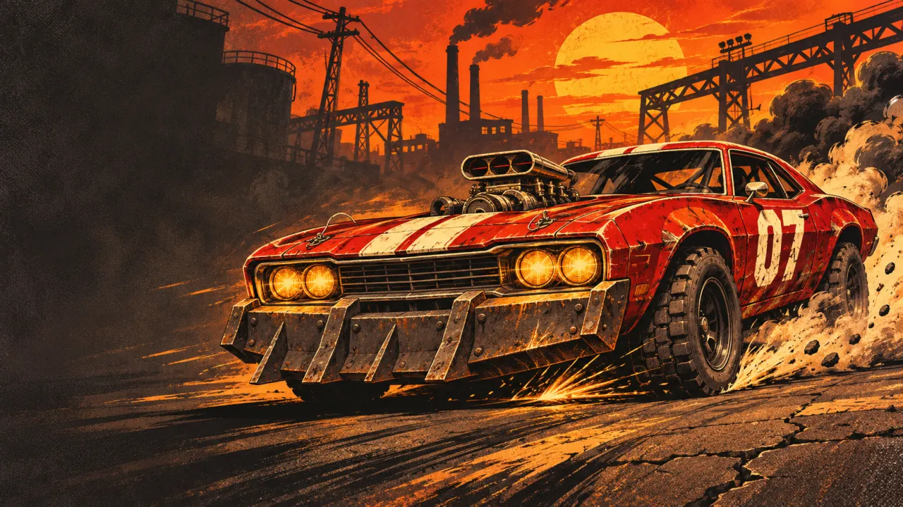

# Carmageddon · Wreck District

Wreck District is an unofficial browser demo inspired by Carmageddon. Drive the No. 07 Interceptor around a sunset steelworks, with three rival drivers and a clock that starts at 48 seconds.

[Play Wreck District](https://smashi.app/arcade/wreck-district-astra/) · [Smashi build details](https://smashi.app/games/carmageddon/wreck-district-astra/)



## Win the event

Pass all ten gates in order on each of two laps, or wreck all three rivals. Either route wins. Watch the arrow and the highlighted gate on the minimap to find the next checkpoint.

Each gate adds three seconds and replenishes some nitro. Wrecking a rival earns six seconds. Ramming with nitro inflicts more damage. Glancing blows conserve armor. Running out of time or armor ends the event. The results screen records your score and offers a fresh race.

## Controls

| Action | Keyboard | Touch |
| --- | --- | --- |
| Accelerate | W or Up | Gas |
| Brake, then reverse | S or Down | Brake |
| Steer | A / D or Left / Right | Left / right arrows |
| Nitro while accelerating | Shift | Nitro |
| Handbrake | Space | Drift |
| Pause or resume | Esc or P | Pause / Resume |
| Toggle sound | M | Speaker |
| Toggle fullscreen on supported browsers | F | Fullscreen |

Select **How to Play** to open the driver manual. Losing window focus pauses the race. The build saves the personal best and sound preference in local browser storage.

## Run locally

From the repository root, start a static server.

```sh
python3 -m http.server 8000
```

Open [localhost on port 8000](http://localhost:8000/). The game loads its JavaScript, textures, fonts, and renderer from the same folder. A 2D overhead view uses the same simulation if the browser cannot create a WebGL renderer.

## Build credits

- Built with Codex using GPT-6.2 Astra at Ultra reasoning effort. The game development prompt, build duration, UTC completion time, and catalog fields are in [the Smashi entry](smashi.json).
- The race simulation is in [sim.js](sim.js). The custom car models, steelworks and chase camera are in [world.js](world.js). [audio.js](audio.js) synthesizes the engine, tire, impact and checkpoint sounds using Web Audio.
- Original title artwork was created with built-in ImageGen. The [in-game illustration](assets/key-art.webp) and [1280 × 720 arcade cover](assets/cover.webp) are included locally.
- Three.js is distributed under the [MIT license](assets/licenses/three.txt). Barlow Condensed by Jeremy Tribby uses the [SIL Open Font License](assets/licenses/barlow-condensed.txt).

<details>
<summary>Title artwork prompt</summary>

Use case: stylized-concept. Asset type: wide 16:9 illustrated key art for a retro PC demolition racing game title screen. A huge brutal cherry-red 1970s muscle car with a heavy gunmetal industrial ram bumper, exposed supercharger and a white weathered '07' on the door, knobby black wheels, white racing stripes. It is sliding toward the viewer / left, front three-quarter view from low down, iconic aggressive silhouette, front end near x=56%, entire vehicle concentrated between x=43% and x=95%, around middle height. Electric golden amber headlamps, vehicle body clearly red. Dark smoke boiling behind on the right, an orange blazing industrial sunset, silhouetted steel gantries and smokestacks, power cables, a little debris, speed lines and sparks, long cast shadow on gritty asphalt. The entire LEFT 35% of frame is dark muted low-detail industrial shadowed haze with negative space intended for a real game title overlay. Vintage hand-painted late-90s PC big box racing cover meets high-contrast screen-printed comic illustration with bold thick ink contours, gritty halftone grain, sun-bleached golden highlights, deep charcoal shadows, confident angular graphic shapes, illustrated NOT photographic and not pixel art. Strong limited palette of sooty charcoal, burnt orange, glowing ochre, racing scarlet and cream. Composition is wide panoramic, a finished collectible game poster illustration, no lettering except car number, no logos, no trademarks, no pedestrians, no border, no interface. Do not place a title within the image.

</details>
